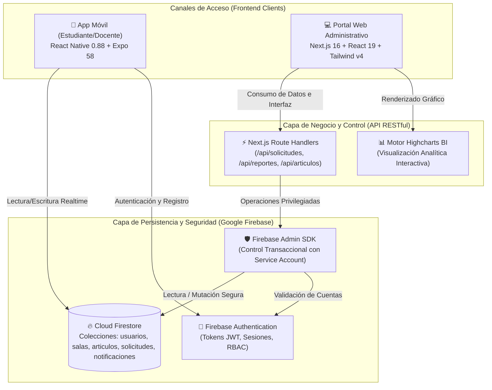
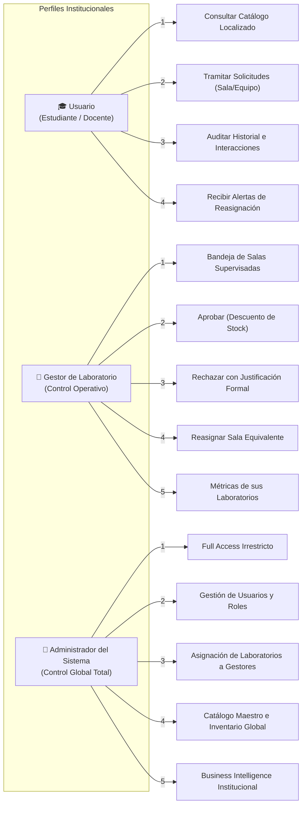
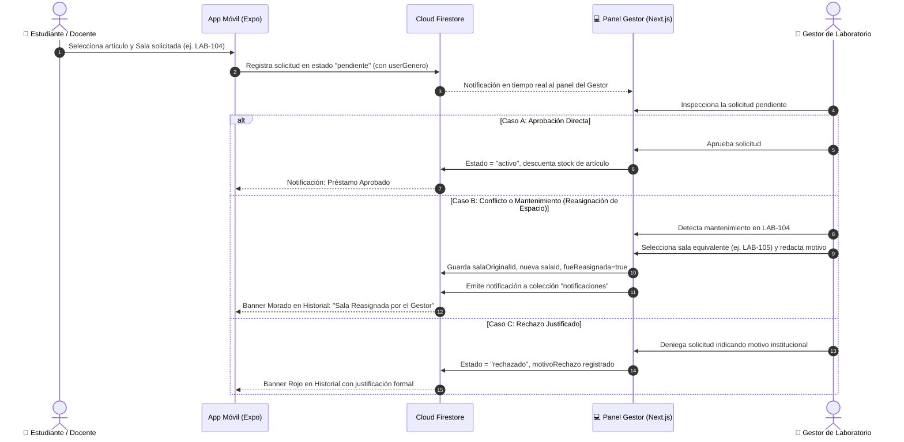

# 🧪 PrestaLab — Sistema Integral de Gestión de Laboratorios, Trazabilidad de Préstamos y Business Intelligence

> **Documento Oficial de Presentación y Defensa Técnica de Proyecto**  
> **Ecosistema Multiplataforma:** Mobile App (React Native / Expo) + Web Backoffice (Next.js 16 Turbopack) + Cloud Architecture (Firebase Firestore & Auth) + Motor BI (Highcharts).
>
> **Actualizacion 2026:** la app movil ya no usa Firebase en el cliente. Consume la API de Vercel (`/api/mobile/*`, JWT y `EXPO_PUBLIC_API_VERCEL`). Firebase Admin queda solo del lado del servidor..

---

## 📑 Tabla de Contenidos

1. [Ficha Técnica del Proyecto](#-1-ficha-técnica-del-proyecto)
2. [Justificación y Planteamiento del Problema](#-2-justificación-y-planteamiento-del-problema)
3. [Arquitectura Global del Sistema](#-3-arquitectura-global-del-sistema)
4. [Estructura del Repositorio](#-4-estructura-del-repositorio)
5. [Matriz de Roles y Permisos (RBAC)](#-5-matriz-de-roles-y-permisos-rbac)
6. [Flujo de Vida del Préstamo y Reasignación Dinámica](#-6-flujo-de-vida-del-préstamo-y-reasignación-dinámica)
7. [Módulos del Sistema por Plataforma](#-7-módulos-del-sistema-por-plataforma)
   - [7.1 Aplicación Móvil (Estudiante / Docente)](#71-aplicación-móvil-react-native--expo)
   - [7.2 Plataforma Web Administrativa (Gestores y Admin)](#72-plataforma-web-administrativa-nextjs-16)
8. [Módulo de Business Intelligence y Analítica (Highcharts)](#-8-módulo-de-business-intelligence-y-analítica-highcharts)
   - [8.1 Reporte de Inventario: Daños, Pérdidas y Buen Estado](#reporte-1-inventario-físico-daños-pérdidas-y-buen-estado)
   - [8.2 Reporte de Uso y Saturación de Laboratorios](#reporte-2-uso-demanda-y-horas-pico-de-laboratorios)
   - [8.3 Reporte General de Préstamos y Tipología](#reporte-3-distribución-institucional-de-préstamos)
   - [8.4 Reporte Multidimensional: Género, Sala, Usuario y Fechas](#reporte-4-segmentación-multidimensional-género--sala--usuario)
9. [Modelo de Datos en Cloud Firestore](#-9-modelo-de-datos-en-cloud-firestore)
10. [Seguridad, Auditoría y Concurrencia](#-10-seguridad-auditoría-y-concurrencia)
11. [Guion de Defensa en Vivo (Pitch para Jurados)](#-11-guion-de-defensa-en-vivo-pitch-para-evaluadores)
12. [Guía de Instalación y Ejecución Local](#-12-guía-de-instalación-y-ejecución-local)

---

## 📋 1. Ficha Técnica del Proyecto

| Parámetro | Detalle Institucional |
| :--- | :--- |
| **Nombre del Sistema** | **PrestaLab Ecosystem** |
| **Tipo de Solución** | Sistema Empresarial Distribuido (Cliente Móvil + Servidor/Portal Web + BaaS Cloud) |
| **Frontend Móvil** | React Native 0.88, Expo SDK 58, React 19, React Navigation 7, Material Community Icons |
| **Frontend Web** | Next.js 16.4 (App Router con Turbopack), React 19, TypeScript 5, Tailwind CSS v4 |
| **Motor Gráfico (BI)** | Highcharts v13, Highcharts React Official v3 (Integración SSR-Safe con React 19) |
| **Backend / Persistencia** | Cloud Firestore NoSQL, Firebase Authentication, Firebase Admin SDK v14 |
| **Identificador Cloud** | `prestalab-f2436` (Google Cloud Platform) |
| **Patrón Arquitectónico** | Arquitectura por Capas con API RESTful Centralizada y Enrutamiento RBAC |

---

## 🎯 2. Justificación y Planteamiento del Problema

### El Problema
En las instituciones de educación superior y centros de investigación tecnológica, la administración de laboratorios físicos y sus activos enfrenta graves fricciones operativas:
1. **Ineficiencia y Descontrol en Papel o Planillas:** Solicitudes gestionadas informalmente o en hojas de cálculo aisladas, propensas a pérdida de trazabilidad.
2. **Saturación No Monitoreada de Espacios:** Ciertas salas experimentan sobrecupo en horarios pico mientras otros laboratorios equivalentes permanecen desaprovechados.
3. **Pérdida y Deterioro Silencioso de Activos:** Falta de un censo continuo que distinga entre equipos en **buen estado**, **dañados en reparación** o **pérdidas definitivas**.
4. **Rigidez ante Contingencias:** Cuando un laboratorio entra en mantenimiento o surge un cruce horario, no existía un mecanismo formal para reasignar al estudiante a una sala equivalente sin cancelar el trámite.

### La Solución: PrestaLab
PrestaLab resuelve de punta a punta este ecosistema:
- **Canal Móvil Estudiantil:** Catálogo localizado en tiempo real, registro con perfil demográfico (género) y solicitud de préstamos con auditoría de estado.
- **Canal Web Operativo:** Panel de toma de decisiones para Gestores de Laboratorio con facultad de aprobar, rechazar con motivo justificado o reasignar salas.
- **Canal Web Gerencial (BI):** Motor analítico impulsado por **Highcharts** con filtros paramétricos por rango de fechas, laboratorios, categorías, condiciones y variables demográficas.

---

## 🏗 3. Arquitectura Global del Sistema

PrestaLab implementa una arquitectura híbrida donde **Cloud Firestore** actúa como la fuente unificada de datos (*Single Source of Truth*), garantizando consistencia en tiempo real entre la aplicación móvil y la consola de administración web.



---

## 📁 4. Estructura del Repositorio

```text
d:\movil2\
├── README.md                           # Master Document de Defensa Técnica del Proyecto
│
├── prestalab-app-update/               # [CANAL MÓVIL] Aplicación React Native con Expo
│   ├── src/
│   │   ├── config/fbConfig.js          # Inicialización del cliente Firebase Web SDK
│   │   ├── contexts/userContext.js     # Contexto de sesión y enriquecimiento con perfil Firestore (género, rol)
│   │   ├── services/
│   │   │   ├── authService.js          # Registro (con chip Sexo/Género), Login y Reset
│   │   │   └── firestoreService.js     # Subscripciones en tiempo real a préstamos, catálogo y salas
│   │   ├── screens/
│   │   │   ├── homeScreen.js           # Inicio: préstamos activos, vencimientos y alertas proactivas
│   │   │   ├── loanRequestScreen.js    # Trámite de solicitud (selección de sala, fecha, motivo y género)
│   │   │   ├── loanHistoryScreen.js    # Trazabilidad completa: banners de reasignación y justificación de rechazo
│   │   │   ├── articulosScreen.js      # Catálogo de inventario clasificado por sala física
│   │   │   ├── articleDetailScreen.js  # Especificaciones técnicas del artículo
│   │   │   ├── registerScreen.js       # Formulario con selector de chips Sexo/Género
│   │   │   └── loginScreen.js          # Inicio de sesión institucional
│   │   └── theme/palette.js            # Sistema de tokens y paleta institucional
│   └── package.json
│
└── prestalab-web/                      # [CANAL WEB & BACKEND] Plataforma Next.js 16 Turbopack
    ├── serviceAccountKey.json          # Credenciales privadas de Firebase Admin SDK
    ├── src/
    │   ├── app/
    │   │   ├── page.tsx                # Dashboard General con KPIs ejecutivos y solicitudes urgentes
    │   │   ├── prestamos/page.tsx      # Gestión Operativa: Aprobación, Rechazo formal y Reasignación de sala
    │   │   ├── salas/page.tsx          # Gestión de Infraestructura: Catálogo maestro de laboratorios
    │   │   ├── inventario/page.tsx     # Control de Activos clasificados por condición (Buen Estado, Dañado, Perdido)
    │   │   ├── usuarios/page.tsx       # Directorio, asignación de roles y vinculación de salas a gestores
    │   │   ├── analitica/page.tsx      # Motor BI con Highcharts: 4 reportes interactivos con filtros de fecha
    │   │   ├── login/page.tsx          # Autenticación Web
    │   │   └── api/                    # API RESTful centralizada
    │   │       ├── articulos/          # GET/POST catálogo y control de stock
    │   │       ├── notificaciones/     # GET/PUT centro de alertas en tiempo real
    │   │       ├── reportes/           # Endpoints analíticos paramétricos
    │   │       │   ├── inventario/     # Métricas de condición física (Buen Estado, Dañado, Perdido)
    │   │       │   ├── uso-laboratorios/# Horas de ocupación, saturación y detección de horas pico
    │   │       │   ├── prestamos/      # Distribución de solicitudes y tipos de recurso
    │   │       │   ├── segmentado/     # Análisis multidimensional: Género x Sala x Usuario
    │   │       │   ├── salas/          # Métricas de laboratorios
    │   │       │   └── usuarios/       # Comportamiento individual de estudiantes y docentes
    │   │       ├── seed/               # Endpoint para inicialización demo de base de datos
    │   │       └── solicitudes/        # Endpoints transaccionales: aprobar, reasignar y rechazar
    │   ├── components/
    │   │   ├── ChartWrapper.tsx        # Componente cliente optimizado para Highcharts en Next.js 16 SSR
    │   │   ├── Header.tsx              # Encabezado con centro de notificaciones push/in-app y semillero
    │   │   └── Sidebar.tsx             # Conmutador de roles dinámico para pruebas en vivo
    │   └── types/index.ts              # Tipado TypeScript estricto de todo el dominio
    └── package.json
```

---

## 👥 5. Matriz de Roles y Permisos (RBAC)

El sistema opera bajo un esquema de **Control de Acceso Basado en Roles (RBAC)** estricto:



1. **Usuario (Estudiante / Docente):** Orientado al consumo de recursos. Puede visualizar la disponibilidad física de los laboratorios en tiempo real, solicitar préstamos especificando fechas y justificación, y auditar cronológicamente sus trámites anteriores.
2. **Gestor de Laboratorio:** Responsable operativo de los laboratorios físicos que le fueron asignados por el administrador. Dispone de una bandeja de decisión para aprobar o rechazar solicitudes (con justificación obligatoria). Cuenta con la facultad exclusiva de **reasignar la sala solicitada por otra equivalente** cuando existan cruces de horario o mantenimiento.
3. **Administrador del Sistema:** Acceso total (*Full Access*). Configura el catálogo maestro de salas, administra usuarios, asigna qué laboratorios específicos supervisa cada gestor, y analiza la salud institucional en el módulo de Business Intelligence.

---

## 🔄 6. Flujo de Vida del Préstamo y Reasignación Dinámica

Uno de los pilares de innovación del proyecto es la **gestión dinámica de conflictos de espacio**:



---

## 📱 7. Módulos del Sistema por Plataforma

### 7.1 Aplicación Móvil (React Native / Expo)
* **Registro Inclusivo con Sexo/Género (`registerScreen.js`):** Permite registrarse seleccionando género mediante chips (`Masculino`, `Femenino`, `Otro`), información que nutre el módulo de analítica demográfica.
* **Catálogo Localizado (`articulosScreen.js`):** Búsqueda de recursos clasificados por el laboratorio físico donde se encuentran almacenados (`salaId`).
* **Trámite de Solicitud (`loanRequestScreen.js`):** Formulario para reservar salas físicas o solicitar equipos, calculando fechas y comunicándose de inmediato con el gestor.
* **Historial de Préstamos con Trazabilidad (`loanHistoryScreen.js`):** 
  - Filtro por estado: `Todos`, `Pendientes`, `Activos`, `Devueltos`, `Rechazados`.
  - **Banner de Reasignación:** Notifica claramente al estudiante: *"Sala Reasignada por el Gestor: Solicitada originalmente LAB-104 &rarr; Asignada LAB-105"* con el motivo institucional.
  - **Banner de Rechazo:** Informa la justificación emitida por el gestor.
* **Home Proactivo (`homeScreen.js`):** Semáforo de vencimientos (días restantes o vencido) y acceso directo a devoluciones.

### 7.2 Plataforma Web Administrativa (Next.js 16)
* **Dashboard Central (`/`):** Indicadores en tiempo real de solicitudes urgentes, laboratorios operativos, préstamos activos e inventario en circulación.
* **Bandeja de Préstamos (`/prestamos`):**
  - **Aprobar:** Descuenta inventario y activa el préstamo.
  - **Rechazar:** Modal con campo de validación obligatorio para justificar el rechazo.
  - **Reasignar Sala:** Modal que lista las salas del campus para trasladar la solicitud preservando la sala original y notificando al estudiante.
* **Gestión de Salas (`/salas`):** Alta, edición, código oficial, capacidad de estudiantes, edificio y conmutadores rápidos de estado (**Disponible**, **Ocupado**, **Mantenimiento**).
* **Gestión de Inventario Localizado (`/inventario`):**
  - Control por laboratorio físico y categoría.
  - Clasificación dual: **Estado Operativo** (*Operativo*, *En Reparación*, *De Baja*) y **Condición Física** (*Buen Estado*, *Dañado*, *Perdido*).
* **Directorio de Usuarios (`/usuarios`):** Control RBAC, visualización de género, y matriz de asignación de laboratorios para cada gestor.
* **Centro de Notificaciones en Encabezado (`Header.tsx`):** Campana interactiva con contador de eventos no leídos (aprobaciones, reasignaciones y rechazos) en tiempo real.

---

## 📊 8. Módulo de Business Intelligence y Analítica (Highcharts)

Implementado en [`analitica/page.tsx`](file:///d:/movil2/prestalab-web/src/app/analitica/page.tsx) utilizando **Highcharts** con renderizado cliente seguro mediante [`ChartWrapper.tsx`](file:///d:/movil2/prestalab-web/src/components/ChartWrapper.tsx). El módulo cuenta con un panel superior de **Filtros Paramétricos** que permite segmentar cualquier métrica por **Laboratorio**, **Rango de Fechas (Fecha Inicio &ndash; Fecha Fin)**, **Categorías**, **Condiciones** y **Roles**.

```text
┌────────────────────────────────────────────────────────────────────────────────────────────────┐
│  MÓDULO DE BUSINESS INTELLIGENCE — PRESTALAB                                                  │
├──────────────────┬───────────────────┬───────────────────┬─────────────────────────────────────┤
│ 1. INVENTARIO    │ 2. USO DE SALAS   │ 3. PRÉSTAMOS      │ 4. SEGMENTADO MULTIDIMENSIONAL      │
│ (Daños/Pérdidas) │ (Horas Pico/Uso)  │ (Estados y Tipos) │ (Género x Sala x Usuario x Fechas)  │
└──────────────────┴───────────────────┴───────────────────┴─────────────────────────────────────┘
```

### Reporte 1: Inventario Físico (Daños, Pérdidas y Buen Estado)
* **Objetivo de Gestión:** Identificar el índice de degradación y extravío de equipos para planificar presupuestos de reposición.
* **Filtros:** Laboratorio, Rango de Fechas de registro, Categoría y Condición Física.
* **Visualizaciones Highcharts:**
  - **Donut Chart:** Proporción de activos en **Buen Estado** (Verde), **Dañados** (Ámbar) y **Perdidos** (Rojo).
  - **Column Chart Comparativo:** Unidades dañadas vs. perdidas desglosadas por cada laboratorio físico.
* **KPIs Directos:** Unidades en buen estado, equipos en mantenimiento técnico y pérdidas registradas.

### Reporte 2: Uso, Demanda y Horas Pico de Laboratorios
* **Objetivo de Gestión:** Evitar cuellos de botella y balancear la carga horaria académica entre facultades.
* **Filtros:** Laboratorio y Rango de Fechas.
* **Visualizaciones Highcharts:**
  - **Bar Chart Horizontal:** Comparativa de **Horas Ocupadas** vs. **Total de Reservas** por sala.
* **Algoritmo de Detección:**
  - Cálculo de **Tasa de Ocupación Semanal** porcentual.
  - Clasificación automática: **Alta Saturación ($\ge$ 75%)**, **Demanda Media**, **Alta Disponibilidad**.
  - Detección de **Hora Pico** (ej. `10:00 - 12:00`, `14:00 - 16:00`) para sugerir reasignaciones hacia laboratorios multiuso.

### Reporte 3: Distribución Institucional de Préstamos
* **Objetivo de Gestión:** Auditar el embudo de trámites académicos y el tipo de recurso más demandado.
* **Filtros:** Estado de Solicitud (`pendiente`, `aprobado`, `activo`, `devuelto`, `rechazado`), Sala y Rango de Fechas.
* **Visualizaciones Highcharts:**
  - **Pie Chart:** Desglose porcentual por estado del ciclo de vida.
  - **Column Chart:** Demanda clasificada por **Artículos Individuales**, **Salas Académicas** y **Préstamos Mixtos**.

### Reporte 4: Segmentación Multidimensional (Género + Sala + Usuario)
* **Objetivo de Gestión:** Análisis demográfico de equidad y participación académica en el uso de la infraestructura científica.
* **Filtros:** Laboratorio, Género (`Masculino`, `Femenino`, `Otro`), Rol (`Estudiante`, `Docente`) y Rango de Fechas.
* **Visualizaciones Highcharts:**
  - **Stacked Column Chart (Columnas Apiladas):** Número de préstamos por cada laboratorio, apilando el volumen solicitado por hombres, mujeres y diversidades.
  - **Pie Chart Demográfico:** Proporción global de participación por género.
* **Tabla de Trazabilidad por Usuario:** Listado con horas acumuladas en laboratorios, volumen de solicitudes y catálogo de espacios frecuentados por cada persona.

---

## 🗄 9. Modelo de Datos en Cloud Firestore

Esquema de las principales colecciones estructuradas en el proyecto `prestalab-f2436`:

### Colección `usuarios`
```json
{
  "id": "user-estudiante-1",
  "nombre": "Mateo Gómez",
  "email": "mateo.gomez@estudiantes.edu.co",
  "genero": "Masculino",
  "rol": "estudiante",
  "departamento": "Ingeniería de Sistemas",
  "createdAt": "2026-10-15T08:00:00.000Z"
}
```

### Colección `salas`
```json
{
  "id": "sala-redes-201",
  "nombre": "Laboratorio de Redes y Telecomunicaciones",
  "codigo": "LAB-201",
  "edificio": "Edificio de Ingeniería - Bloque B (Piso 2)",
  "capacidad": 25,
  "tipo": "Redes",
  "estado": "disponible",
  "gestorResponsableId": "user-gestor-1",
  "gestorNombre": "Ing. Carlos Mendoza",
  "equiposCount": 42
}
```

### Colección `articulos`
```json
{
  "id": "art-cisco-switch",
  "nombre": "Switch Cisco Catalyst 2960 24 Puertos",
  "categoria": "Redes",
  "salaId": "sala-redes-201",
  "salaNombre": "Laboratorio de Redes y Telecomunicaciones",
  "stock": 5,
  "stockTotal": 8,
  "estado": "operativo",
  "condicion": "buen_estado",
  "codigoActivo": "ACT-NET-001",
  "fechaRegistro": "2026-10-01"
}
```

### Colección `solicitudes` / `prestamos`
```json
{
  "id": "sol-003",
  "userId": "user-estudiante-2",
  "userNombre": "Valentina Restrepo",
  "userGenero": "Femenino",
  "userRol": "estudiante",
  "salaId": "sala-multiuso-105",
  "salaNombre": "Laboratorio de Prototipado y Proyectos Multiuso",
  "salaOriginalId": "sala-robotica-104",
  "salaOriginalNombre": "Laboratorio de Robótica y Sistemas Embebidos",
  "fueReasignada": true,
  "motivoReasignacion": "Mantenimiento preventivo en LAB-104.",
  "estado": "activo",
  "tipoRecurso": "mixto",
  "fechaInicio": "2026-10-24",
  "fechaFin": "2026-10-27"
}
```

### Colección `notificaciones`
```json
{
  "userId": "user-estudiante-2",
  "tipo": "sala_modificada",
  "titulo": "Espacio Reasignado por el Gestor",
  "mensaje": "Tu solicitud ha sido reasignada a la sala LAB-105 (Original: LAB-104).",
  "prestamoId": "sol-003",
  "leida": false,
  "fecha": "2026-10-24T14:30:00.000Z"
}
```

---

## 🔒 10. Seguridad, Auditoría y Concurrencia

1. **Credenciales Blindadas con Service Account:** La plataforma web se conecta a Firestore mediante `serviceAccountKey.json` con el **Firebase Admin SDK**, otorgando privilegios estrictamente controlados en el servidor y evitando exponer llaves secretas en el cliente.
2. **Descuento Atómico de Inventario:** Al momento de aprobar un préstamo de artículos, el sistema descuenta de forma transaccional el stock disponible, evitando condiciones de carrera (*race conditions*) y sobre-préstamo.
3. **Auditoría con Doble Espejo:** Toda mutación en `solicitudes` se replica de inmediato en la colección `prestamos` y emite un registro inmutable en `notificaciones`.
4. **Verificación de Compilación Exitosa:** El código base cumple al 100% las restricciones de TypeScript en Next.js 16 (0 errores de tipado) y las comprobaciones de sintaxis Node.js en React Native.

---

## 🎤 11. Guion de Defensa en Vivo (Pitch para Evaluadores)

Si vas a sustentar o defender este proyecto ante un comité evaluador o jurado docente, sigue esta secuencia de 5 pasos para una demostración contundente:

### Paso 1: Introducción y Planteamiento del Problema (1 minuto)
> *"Buenos días. PrestaLab es un ecosistema tecnológico diseñado para resolver el descontrol de inventarios y la saturación de laboratorios universitarios. Se compone de una aplicación móvil para estudiantes y docentes, y una plataforma web con Business Intelligence para gestores y administradores."*

### Paso 2: Flujo Móvil Estudiantil con Género (1.5 minutos)
1. Muestra la pantalla de registro en la app móvil ([`registerScreen.js`](file:///d:/movil2/prestalab-app-update/src/screens/registerScreen.js)) destacando el campo **Sexo/Género** como insumo demográfico.
2. Inicia sesión como estudiante y navega al catálogo de inventario ([`articulosScreen.js`](file:///d:/movil2/prestalab-app-update/src/screens/articulosScreen.js)). Demuestra cómo los activos están localizados por sala física.
3. Realiza una solicitud de préstamo en [`loanRequestScreen.js`](file:///d:/movil2/prestalab-app-update/src/screens/loanRequestScreen.js) seleccionando el **Laboratorio de Robótica (LAB-104)**.

### Paso 3: Toma de Decisiones del Gestor y Reasignación de Sala (2 minutos)
1. Pasa a la plataforma web en `http://localhost:3000/prestamos` con el rol de **Gestor de Laboratorio (Ing. Carlos Mendoza)**.
2. Muestra cómo la solicitud del estudiante apareció en tiempo real.
3. Haz clic en **"Reasignar Sala"**:
   - Explica al jurado: *"Supongamos que el LAB-104 presenta una falla eléctrica imprevista. En lugar de rechazar al estudiante, el gestor traslada la solicitud al LAB-105 (Multiuso) registrando el motivo."*
4. Aprueba la solicitud.

### Paso 4: Trazabilidad y Alerta en la App Móvil (1 minuto)
1. Regresa a la app móvil y abre la pantalla **Historial de Préstamos** ([`loanHistoryScreen.js`](file:///d:/movil2/prestalab-app-update/src/screens/loanHistoryScreen.js)).
2. Muestra el **Banner Morado de Reasignación**: *"Aquí el estudiante ve inmediatamente que su sala fue cambiada a LAB-105, el motivo del gestor y que el préstamo fue aprobado sin perder su turno."*
3. Muestra en la web la campana de notificaciones del encabezado con el contador actualizado.

### Paso 5: Demostración del Módulo de Business Intelligence con Highcharts (2.5 minutos)
1. Ingresa a `http://localhost:3000/analitica` como **Administrador del Sistema**.
2. **Pestaña 1 (Inventario):** Muestra el gráfico Donut de Highcharts con las unidades en *Buen Estado*, *Dañadas* y *Perdidas*, y filtra por fecha y laboratorio.
3. **Pestaña 2 (Uso de Salas):** Muestra el gráfico de barras horizontales, explicando cómo el algoritmo detecta laboratorios en **Alta Saturación (>75%)** y sus **Horas Pico**.
4. **Pestaña 4 (Segmentación Multidimensional):** Muestra el gráfico de **Columnas Apiladas (Stacked Columns)** demostrando la distribución de uso por género (*Masculino, Femenino, Otro*) por cada sala académica.
5. Haz clic en **"Exportar Informe"** para evidenciar la capacidad de generar reportes impresos institucionales.

---

## 🚀 12. Guía de Instalación y Ejecución Local

### Prerrequisitos
- **Node.js** v20.x o v22.x instalado.
- Conexión a Internet para la sincronización con Firebase Cloud Firestore.

---

### 12.1 Ejecución de la Plataforma Web (Next.js 16)

```bash
# 1. Navegar a la carpeta web
cd d:\movil2\prestalab-web

# 2. Instalar dependencias (si no se han instalado)
npm install

# 3. Iniciar el servidor de desarrollo con Turbopack
npm run dev
```

- Abre tu navegador en: **`http://localhost:3000`**
- **Poblar Base de Datos Inicial:** Haz clic en el botón superior **"Poblar Datos Demo"** para sembrar automáticamente laboratorios, activos, usuarios y préstamos con todas las condiciones y géneros.
- **Alternar Roles:** Utiliza el selector desplegable en la barra lateral izquierda para alternar entre **Administrador**, **Gestores** y **Estudiantes** sin necesidad de cerrar sesión.

---

### 12.2 Ejecución de la Aplicación Móvil (React Native / Expo)

```bash
# 1. Navegar a la carpeta móvil
cd d:\movil2\prestalab-app-update

# 2. Iniciar el empaquetador Metro de Expo
npx expo start
```

- Presiona `a` para abrir en un emulador Android (o `w` para la versión web de prueba, o escanea el código QR con **Expo Go** en tu dispositivo físico).

---

## 🏆 Resumen de Logros del Proyecto

| Requerimiento Evaluado | Estado | Implementación Técnica |
| :--- | :---: | :--- |
| **1. Matriz de Roles (RBAC)** | **100%** | Perfiles Estudiante, Docente, Gestor y Administrador con vistas segregadas y permisos en API. |
| **2. Flujo de Préstamo y Reasignación** | **100%** | Aprobación con descuento de inventario, rechazo formal obligatorio y reasignación equivalente. |
| **3. Trazabilidad e Historial** | **100%** | Historial móvil con filtros, banners de reasignación con sala original y motivo del gestor. |
| **4. Sistema de Notificaciones** | **100%** | Colección `notificaciones`, centro de alertas con campana en web y feedback proactivo en móvil. |
| **5. Inventario Clasificado por Condición** | **100%** | Categorización en **Buen Estado**, **Dañado** y **Perdido**, filtrable en web y editable en modal. |
| **6. Campo Sexo / Género** | **100%** | Chips en registro móvil, persistencia en Firestore `usuarios` y visualización en tablas y filtros. |
| **7. Dashboard y Reportes Highcharts** | **100%** | 4 vistas analíticas completas (Inventario, Uso de Salas, Préstamos y Segmentación Género x Sala). |

---

*PrestaLab &mdash; Desarrollado como solución tecnológica de alto impacto para la gestión de infraestructura y analítica académica.*

