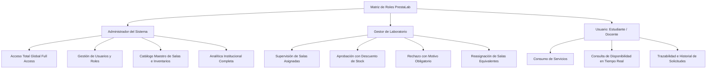

# 🧪 PrestaLab Web — Plataforma Administrativa, Centralizada y Motor BI

Plataforma Web desarrollada con **Next.js 16 (App Router con Turbopack)**, **React 19**, **TypeScript**, **Tailwind CSS v4**, **Highcharts** y **Firebase Admin SDK** para el sistema integral de gestión de préstamos, laboratorios académicos, inventario localizado y Business Intelligence de **PrestaLab**.

---

## 📑 Tabla de Contenidos

- [Visión General y Ficha Técnica](#-visión-general-y-ficha-técnica)
- [Stack Tecnológico](#-stack-tecnológico)
- [Matriz de Roles y Permisos (RBAC)](#-matriz-de-roles-y-permisos-rbac)
- [Módulos y Funcionalidades](#-módulos-y-funcionalidades)
  - [1. Dashboard Central](#1-dashboard-central)
  - [2. Gestión Dinámica de Préstamos y Asignaciones](#2-gestión-dinámica-de-préstamos-y-asignaciones)
  - [3. Salas y Laboratorios Académicos](#3-salas-y-laboratorios-académicos)
  - [4. Gestión de Inventario Localizado (Condición Física)](#4-gestión-de-inventario-localizado-condición-física)
  - [5. Directorio de Usuarios y Género](#5-directorio-de-usuarios-y-género)
  - [6. Módulo de Business Intelligence con Highcharts](#6-módulo-de-business-intelligence-con-highcharts)
  - [7. Centro de Notificaciones en Tiempo Real](#7-centro-de-notificaciones-en-tiempo-real)
- [Arquitectura de API RESTful](#-arquitectura-de-api-restful)
- [Estructura de Base de Datos (Firestore)](#-estructura-de-base-de-datos-firestore)
- [Cuentas Preconfiguradas para Pruebas](#-cuentas-preconfiguradas-para-pruebas)
- [Requisitos Previos e Instalación](#-requisitos-previos-e-instalación)
- [Comandos Disponibles](#-comandos-disponibles)

---

## 🔭 Visión General y Ficha Técnica

PrestaLab Web centraliza la toma de decisiones, la asignación de recursos y el análisis de ocupación de laboratorios para universidades e instituciones educativas. Actúa como el **cerebro administrativo** y la **fuente única de datos (Single Source of Truth)** para todas las plataformas, proveyendo endpoints RESTful transaccionales a la aplicación móvil.

---

## 🛠 Stack Tecnológico

| Capa | Tecnología | Descripción |
| :--- | :--- | :--- |
| **Framework Web** | [Next.js 16.4](https://nextjs.org/) | App Router con Turbopack, React Server Components y Server Route Handlers. |
| **Lenguaje** | [TypeScript 5](https://www.typescriptlang.org/) | Tipado estricto para entidades, solicitudes, respuestas y modelos BI. |
| **Estilos & UI** | [Tailwind CSS v4](https://tailwindcss.com/) | Interfaz moderna, paleta esmeralda/índigo institucional y diseño responsivo. |
| **Motor Gráfico (BI)** | [Highcharts v13](https://www.highcharts.com/) + `highcharts-react-official` | Renderizado interactivo cliente con integración SSR-safe para React 19. |
| **Iconografía** | [Lucide React](https://lucide.dev/) | Iconografía vectorial accesible y consistente. |
| **Backend & Base de Datos** | [Firebase Admin SDK v14](https://firebase.google.com/) | Acceso transaccional administrativo directo a Cloud Firestore y Firebase Auth. |
| **Proyecto Firebase** | `prestalab-f2436` | Entorno centralizado en Google Cloud Platform. |

---

## 👤 Matriz de Roles y Permisos (RBAC)

La plataforma cuenta con un **Selector Dinámico de Rol** en la barra lateral (`Sidebar`) que permite auditar y defender el sistema desde cualquier perfil en tiempo real:



---

## 📦 Módulos y Funcionalidades

### 1. Dashboard Central (`/`)
* **KPIs en tiempo real:** Solicitudes pendientes de evaluación, préstamos activos en curso, total de salas disponibles/mantenimiento e inventario prestado.
* **Bandeja de Acción Rápida:** Acceso directo a las solicitudes urgentes que requieren decisión inmediata del gestor.
* **Monitoreo de Laboratorios:** Estado visual de la infraestructura del campus.

### 2. Gestión Dinámica de Préstamos y Asignaciones (`/prestamos`)
* **Filtros avanzados:** Filtrado por estado (`Todos`, `Pendiente`, `Activo`, `Devuelto`, `Rechazado`), laboratorio y buscador en vivo.
* **Modal de Aprobación:** Confirmación de préstamo con descuento atómico automático de stock.
* **Modal de Rechazo con Justificación:** Validación estricta que exige redactar el motivo técnico o institucional del rechazo.
* **Modal de Reasignación de Sala:** Selector de salas equivalentes disponibles con registro de sala original, nuevo espacio y justificación formal comunicada al estudiante.

### 3. Salas y Laboratorios Académicos (`/salas`)
* Catálogo de espacios físicos con código institucional (`LAB-201`, `SALA-302`, etc.), capacidad física, edificio/piso, especialidad y gestor asignado.
* Conmutadores rápidos de estado operativo: **Libre / Disponible**, **Ocupado**, **Mantenimiento**.

### 4. Gestión de Inventario Localizado (Condición Física) (`/inventario`)
* **Inventario clasificado por sala física:** Cada equipo, cable, herramienta o instrumento está asociado a un laboratorio específico.
* **Clasificación por Condición Física:** Badges distintivos para **Buen Estado** (Verde), **Dañado** (Ámbar) y **Perdido** (Rojo).
* **Filtros paramétricos:** Filtrado simultáneo por Laboratorio, Categoría y Condición Física.
* Modal para dar de alta nuevos activos o actualizar niveles de stock y condición.

### 5. Directorio de Usuarios y Género (`/usuarios`)
* Directorio completo de usuarios (Estudiantes, Docentes, Gestores, Administradores).
* **Columna de Género:** Badges clasificados para *Masculino*, *Femenino* y *Otro*.
* **Asignación de Laboratorios para Gestores:** Interfaz con casillas de verificación para vincular qué salas específicas supervisa operativamente cada gestor.

### 6. Módulo de Business Intelligence con Highcharts (`/analitica`)
Integrado en 4 secciones analíticas con panel superior de **Filtros Paramétricos** (Laboratorio, Fechas, Categorías, Condiciones, Roles):
1. **Reporte de Inventario:** Gráfica Donut (Buen Estado vs. Dañado vs. Perdido) y Gráfica de Columnas por Laboratorio.
2. **Reporte de Uso de Salas:** Gráfica de barras de Horas Ocupadas, cálculo de Tasa de Ocupación, detección automática de **Horas Pico** y clasificación de saturación.
3. **Reporte General de Préstamos:** Distribución por estados y demanda por tipo de recurso (Artículos vs. Salas vs. Mixto).
4. **Reporte Segmentado Multidimensional:** Gráfica de **Columnas Apiladas (Stacked Columns)** de préstamos por sala cruzados con el género del usuario (*Masculino, Femenino, Otro*) y tabla de auditoría individual por usuario.
* **Exportación de Informes:** Botón para imprimir o exportar a PDF el informe ejecutivo en alta definición.

### 7. Centro de Notificaciones en Tiempo Real (`Header.tsx`)
* Campana interactiva en el encabezado con contador dinámico de notificaciones no leídas.
* Menú desplegable con eventos recientes (Préstamos aprobados, Salas reasignadas, Justificaciones de rechazo).
* Botón de **"Marcar leídas"** sincronizado contra la API `/api/notificaciones`.

---

## 🖥 Arquitectura de API RESTful

| Método | Endpoint | Descripción |
| :--- | :--- | :--- |
| `POST` | `/api/auth/login` | Inicia sesión con Firebase Auth y emite cookie httpOnly firmada. |
| `POST` | `/api/auth/register` | Crea la cuenta en Firebase Auth y el perfil en `usuarios` (rol estudiante). |
| `POST` | `/api/auth/logout` | Cierra la sesión y borra la cookie. |
| `GET` | `/api/auth/me` | Devuelve el usuario de la sesión activa. |
| `POST` | `/api/mobile/auth/login` | Login de la app móvil; devuelve JWT + perfil. |
| `POST` | `/api/mobile/auth/register` | Registro móvil (rol estudiante) + JWT. |
| `GET` | `/api/mobile/auth/me` | Perfil de la sesión móvil (Bearer). |
| `POST` | `/api/mobile/auth/recuperar` | Envía el correo de recuperación de contraseña. |
| `GET` | `/api/mobile/sync` | Pull móvil: salas, artículos, préstamos y notificaciones. |
| `POST` | `/api/mobile/prestamos` | Crea una solicitud desde la app (idempotente por `clientId`). |
| `PATCH` | `/api/mobile/prestamos/[id]` | Registra la devolución del préstamo del usuario. |
| `POST` | `/api/seed` | Inicializa Firestore con laboratorios, artículos, usuarios y préstamos demo. |
| `GET` | `/api/stats` | Retorna los totales y KPIs ejecutivos para el Dashboard. |
| `GET, POST` | `/api/solicitudes` | Lista solicitudes con filtros o tramita una nueva solicitud. |
| `POST` | `/api/solicitudes/[id]/aprobar` | Aprueba la solicitud, descuenta stock y emite notificación. |
| `POST` | `/api/solicitudes/[id]/rechazar` | Rechaza la solicitud requiriendo `motivoRechazo` obligatorio. |
| `POST` | `/api/solicitudes/[id]/reasignar` | Reasigna a otra sala equivalente registrando sala previa, nuevo espacio y motivo. |
| `GET, PUT` | `/api/notificaciones` | Consulta notificaciones del usuario o marca como leídas. |
| `GET` | `/api/reportes/inventario` | Métricas de condición física (Buen Estado, Dañado, Perdido) con filtros de fecha. |
| `GET` | `/api/reportes/uso-laboratorios`| Ocupación de salas, horas de uso y horas pico. |
| `GET` | `/api/reportes/prestamos` | Distribución por estados y tipología de recursos. |
| `GET` | `/api/reportes/segmentado` | Análisis cruzado multidimensional: Género x Sala x Usuario x Fechas. |
| `GET, POST` | `/api/salas` | Lista o registra nuevos laboratorios académicos. |
| `PUT, DELETE` | `/api/salas/[id]` | Actualiza o elimina un laboratorio existente. |
| `GET, POST` | `/api/articulos` | Lista inventario (soporta `salaId`, `categoria`) o registra un nuevo activo. |
| `PUT, DELETE` | `/api/articulos/[id]` | Modifica stock/condición o elimina un artículo del inventario. |
| `GET, POST` | `/api/usuarios` | Directorio de usuarios con género o alta con rol RBAC. |
| `PUT` | `/api/usuarios/[id]` | Actualiza rol, género y laboratorios supervisados por el gestor. |

---

## 🚀 Requisitos Previos e Instalación

### 1. Requisitos
* **Node.js** v20.x o v22.x instalado.
* Conexión a Internet para la sincronización con Firebase Firestore.

### 2. Instalación de Dependencias
```bash
cd d:\movil2\prestalab-web
npm install
```

### 3. Comandos Disponibles
| Comando | Acción |
| :--- | :--- |
| `npm run dev` | Inicia el servidor de desarrollo en `http://localhost:3000` con Turbopack. |
| `npm run build` | Compila la aplicación para producción verificando tipos y optimizando rutas. |
| `npm start` | Inicia el servidor de producción compilado. |
| `npm run lint` | Ejecuta ESLint para validar el estándar de código. |

---

## 👥 Cuentas Preconfiguradas para Pruebas

| Perfil | Nombre | Correo | Rol | Alcance / Permisos |
| :--- | :--- | :--- | :--- | :--- |
| **Administrador** | Ing. Mateo Gómez | `admin.prestalab@universidad.edu.co` | `admin` | Acceso global total a todas las salas y configuraciones. |
| **Gestor 1** | Ing. Carlos Mendoza | `carlos.mendoza@universidad.edu.co` | `gestor` | Supervisa: `LAB-201` (Redes), `LAB-104` (Robótica), `LAB-205` (Sensores). |
| **Gestor 2** | Dra. Elena Silva | `elena.silva@universidad.edu.co` | `gestor` | Supervisa: `SALA-302` (Cómputo IA) y `LAB-105` (Multiuso). |
| **Estudiante** | Alejandro Morales | `alejandro.morales@estudiantes.edu.co` | `estudiante` | Perfil de usuario solicitante y consumidor. |
| **Docente** | Prof. Javier Ramos | `javier.ramos@universidad.edu.co` | `docente` | Perfil docente con solicitudes de investigación. |
